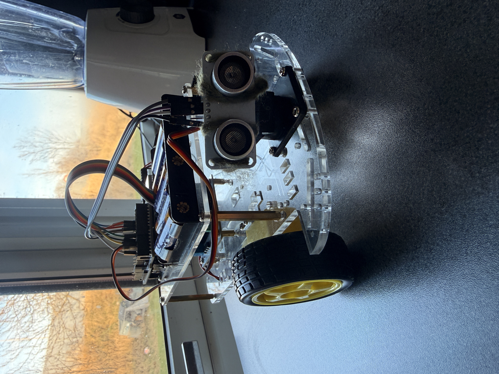
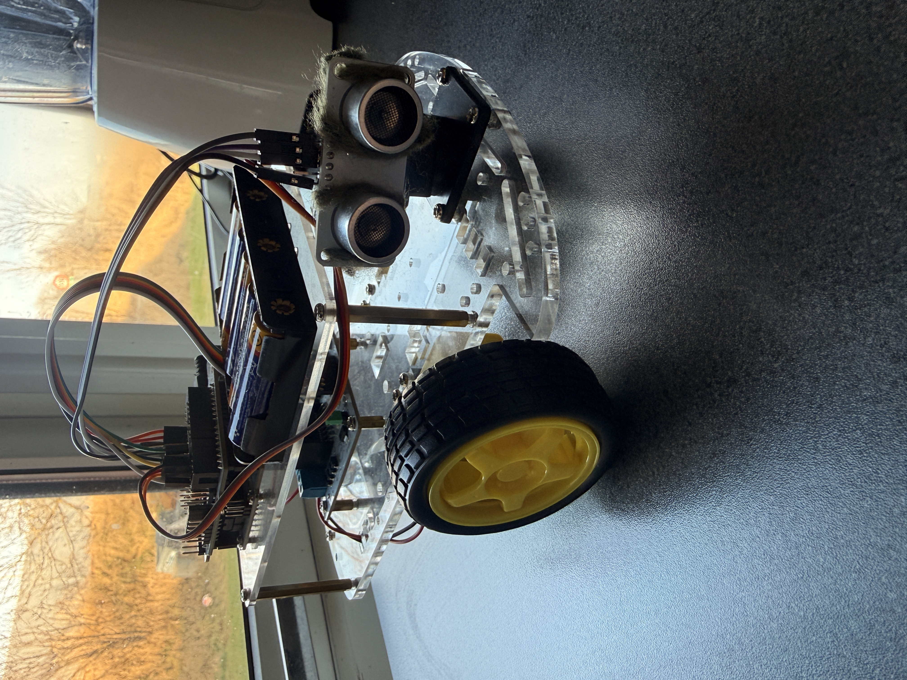

# Arduino Autonomous Robot Car 🤖

An autonomous two-wheel robot car built with Arduino Uno, featuring ultrasonic obstacle detection, servo-based environmental scanning, and PWM motor control.

This project provides an alternative implementation for the **Playknowlogy Arduino Robot Car Kit**, focusing on readable C++ code, configurable navigation behavior, and beginner-friendly documentation.

## About This Project

This repository contains my own implementation of an autonomous robot car based on the **Playknowlogy Arduino Robot Car Kit**.

While assembling and programming the robot, I found that some parts of the provided instructions were difficult to follow, and the example code did not fully cover the functionality I wanted to achieve.

Instead of relying entirely on the original implementation, I decided to develop my own version, experimenting with motor control, ultrasonic sensing, servo movements, and obstacle avoidance.

The goal of this repository is to share my approach, the challenges I encountered, and the solutions I developed along the way.

**If you're building the same robot kit or working on a similar Arduino project, feel free to use, modify, and build upon this code!**

This is a personal learning project and an independent implementation, not an official replacement for the manufacturer's instructions.


## Robot Preview

<p align="center">
  
  
</p>

<p align="center">
  <em>Arduino autonomous robot car featuring ultrasonic sensing, servo scanning, and PWM motor control.</em>
</p>

*The assembled Arduino robot car featuring a two-wheel acrylic chassis, ultrasonic sensor, servo motor, and custom wiring.*

## Project Overview

The robot uses an ultrasonic sensor mounted on a servo motor to detect obstacles and navigate its surroundings.

When an obstacle is detected, the robot stops, scans both directions, and attempts to turn toward the direction with more available space.

The project was developed through hands-on experimentation, hardware troubleshooting, and iterative software improvements.

The goal is to provide an accessible starting point for anyone interested in Arduino-based robotics, autonomous navigation, and embedded programming.

## Features

The initial firmware (v1.0) includes:

- Autonomous forward movement
- Ultrasonic obstacle detection
- Servo-controlled left and right scanning
- Independent PWM control of two DC motors
- Configurable motor speed and obstacle detection distance
- Basic obstacle avoidance
- Serial Monitor debugging output

Additional functionality, including motor calibration, speed reduction near obstacles, Idle Mode, and custom movement patterns, is being explored in experimental versions.

## Hardware

The project is based on the **Playknowlogy Arduino Robot Car Kit**.

| Component | Description |
|---|---|
| Microcontroller | Arduino Uno R3 |
| Motor driver | L298N |
| Motors | 2 × DC geared motors |
| Distance sensor | Ultrasonic sensor (HC-SR04 compatible) |
| Servo | SG90 micro servo |
| Battery supply | 6 × AA batteries |
| Expansion board | Arduino Sensor Shield v5.0 |
| Chassis | Two-wheel acrylic robot chassis |

## Software

- Arduino IDE
- C++ / Arduino
- Arduino Servo library

### Repository Structure

```text
arduino-autonomous-robot-car/
├── firmware/
│   └── RobotCar/
│       └── RobotCar.ino
├── images/
│   ├── robot-image-1.JPEG
│   └── robot-image-2.JPEG
├── .gitignore
├── LICENSE
└── README.md
```

### Firmware

The initial autonomous navigation implementation is available here:

**[RobotCar.ino](firmware/RobotCar/RobotCar.ino)**

The firmware includes configurable parameters for motor speed, obstacle detection, servo angles, and turning behavior.

## How It Works

The robot follows a simple obstacle avoidance algorithm:

1. **Measure distance:** The ultrasonic sensor measures the distance directly ahead.
2. **Move forward:** If the distance is greater than the configured safety threshold, both motors drive forward.
3. **Detect obstacles:** When an obstacle is detected within the safety threshold, the robot stops.
4. **Scan surroundings:** The servo rotates the ultrasonic sensor to measure distances toward the left and right.
5. **Compare distances:** The robot determines which direction has more available space.
6. **Turn:** The motors rotate in opposite directions to turn the robot toward the clearer path.
7. **Repeat:** The robot continuously monitors its surroundings and adjusts its movement.

If the sensor reports an invalid distance, the robot stops rather than continuing forward.

## Getting Started

### 1. Assemble the Robot

Assemble the robot using the instructions supplied with the Playknowlogy Arduino Robot Car Kit.

Ensure that the motors, battery holder, servo, and ultrasonic sensor are securely mounted.

### 2. Verify the Wiring

Check all connections between the Arduino Uno, Sensor Shield, L298N motor driver, servo, and ultrasonic sensor.

Verify the power supply voltage and polarity before connecting the batteries.

**Important:** Do not connect multiple regulated 5 V outputs together without first verifying the power distribution design.

A detailed wiring guide will be added in a future update.

### 3. Download the Firmware

Download or clone this repository:

```bash
git clone https://github.com/Mspetrus04/arduino-autonomous-robot-car.git
```

Open the following file in Arduino IDE:

```text
firmware/RobotCar/RobotCar.ino
```

### 4. Configure Arduino IDE

1. Connect the Arduino Uno to your computer using a USB cable.
2. Open Arduino IDE.
3. Select **Arduino Uno** under Board.
4. Select the correct serial port.
5. Verify and upload the code.

### 5. Test the Robot

1. Disconnect USB after uploading the firmware.
2. Verify the battery and motor driver connections.
3. Perform the initial test with the drive wheels lifted off the ground.
4. Test the robot on a flat, open surface away from stairs and fragile objects.
5. Observe its movement and adjust the configuration parameters if necessary.

The initial firmware has a five-second startup delay.

## Configuration

The firmware contains adjustable settings for different environments and hardware configurations.

| Parameter | Default | Description |
|---|---|---|
| `MOTOR_SPEED` | 140 | Forward motor PWM (0–255) |
| `TURN_SPEED` | 140 | Turning motor PWM (0–255) |
| `SAFE_DISTANCE` | 35 cm | Obstacle detection threshold |
| `TURN_CLEARANCE` | 35 cm | Minimum clearance when selecting a turn |
| `CENTER_ANGLE` | 90° | Servo center position |
| `LEFT_ANGLE` | 150° | Servo left scanning angle |
| `RIGHT_ANGLE` | 30° | Servo right scanning angle |
| `TURN_DURATION` | 400 ms | Duration of each turning movement |

Motor direction can also be adjusted using:

```cpp
const bool REVERSE_RIGHT_MOTOR = false;
const bool REVERSE_LEFT_MOTOR = false;
```

These values may need adjustment depending on motor orientation, wiring, battery condition, and the surface on which the robot operates.

## Project Status

**Experimental — active development**

The initial firmware, **v1.0**, is available in this repository.

Core hardware functionality has been demonstrated, including:

- DC motor control
- Ultrasonic distance measurement
- Servo-controlled scanning
- Basic autonomous obstacle avoidance

The currently published v1.0 source is a simplified baseline and should be independently tested before being considered a verified release.

More advanced navigation behavior and experimental features are being developed separately.

## Future Improvements

- Improved motor calibration for straighter driving
- Better ultrasonic distance filtering
- Dynamic speed adjustment near obstacles
- Optional Idle Mode
- Custom movement patterns and Fun Moves
- Non-blocking navigation using `millis()`
- Smoother acceleration and turning
- More robust obstacle avoidance and recovery
- Detailed wiring diagrams
- Additional testing and troubleshooting documentation

## Disclaimer

This is an independent, community-oriented project and is not officially affiliated with **Playknowlogy** or **Kjell & Company**.

The robot uses basic ultrasonic obstacle detection and cannot guarantee detection of every obstacle.

Always verify wiring, voltage, and polarity before applying power. Test moving components in a controlled environment.

## License

This project is licensed under the MIT License. See [LICENSE](LICENSE) for details.
